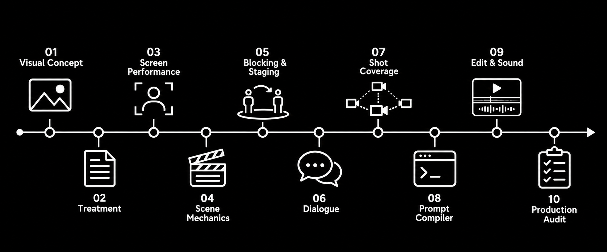

# idea2shot — Cinematic Script-to-Video Pipeline v2

<p align="center">
  <picture>
    <source media="(prefers-color-scheme: dark)" srcset="docs/icon-white.png">
    
  </picture>
</p>

A model-agnostic prompt pipeline that turns a raw idea into generation-ready AI-video shots. Each stage is a standalone prompt (film director, performance director, blocking, dialogue, coverage, prompt compiler, editor, auditor) that converts literary intent into photographable action, playable performance, shot design, sound, and edit logic. Output targets LTX, Runway, Veo, or any generic text/image-to-video model.

No code, no dependencies, no env vars — just Markdown prompts and JSON schemas.



## How to use

1. Load `00-cinematic-constitution.md` as the system/developer prompt. Keep it on for every stage.
2. Send one stage prompt (the ```text block in each file) as the user message, plus that stage's `INPUT`.
3. Review the output. Pass only the approved version to the next stage.
4. Repeat until `10-production-auditor.md` passes the plan.

### With Claude Code (skill)

`skills/idea2shot/` is a Claude Code skill that runs the whole pipeline for you: picks a mode, runs each stage, keeps the four records, audits, and writes final shot prompts to `productions/<slug>/shots.md`.

Install (symlink keeps it in sync with the repo):

```bash
git clone https://github.com/novolg/idea2shot.git
ln -s "$(pwd)/idea2shot/skills/idea2shot" ~/.claude/skills/idea2shot
```

Then ask Claude something like *"Turn this idea into Veo shots: a lighthouse keeper finds a phone ringing inside the lamp room"*, or call it directly with `/idea2shot`. It also handles single stages: *"audit my shot plan"*, *"compile these shots for Runway"*.

## Stages

| # | File | Job |
|---|------|-----|
| 00 | `00-cinematic-constitution.md` | Persistent rules for every stage (filmability rule, carriers). |
| 01 | `01-visual-concept-director.md` | Idea → visually generative concept directions. |
| 02 | `02-cinematic-treatment-designer.md` | Sequence-level audiovisual experience. |
| 03 | `03-screen-performance-designer.md` | Character visual anchors + playable behavior. |
| 04 | `04-scene-mechanics-designer.md` | Each scene reduced to screen events (scene card). |
| 05 | `05-blocking-staging-director.md` | Space map, subject/prop movement, axis of action. |
| 06 | `06-cinematic-dialogue-director.md` | Speakable lines, reactions, coverage cues. |
| 07 | `07-shot-coverage-designer.md` | Editable shot progression. |
| 08 | `08-ai-video-prompt-compiler.md` | Shot record → model-specific generation prompt. |
| 09 | `09-edit-sound-designer.md` | Cuts, sound bridges, rhythm, eye trace. |
| 10 | `10-production-auditor.md` | Rejects unfilmable/unreliable plans and repairs them. |

## Execution modes

| Mode | Stages | Use for |
|------|--------|---------|
| Full | 00 → 10 (all) | Narrative shorts, commercials, dialogue-heavy pieces. |
| Fast | 00 → 01 → 04 → 07 → 08 → 10 | Quick concept-to-shots. |
| Dialogue scene | 00 → 03 → 04 → 05 → 06 → 07 → 08 → 09 → 10 | Single talking scene. |
| Visual montage | 00 → 01 → 02 → 07 → 08 → 09 → 10 | No-dialogue, mood/rhythm pieces. |

## Core rule

Every idea must resolve into something the audience can see or hear. Hidden intent may guide performance internally, but it cannot substitute for screen action.

## Context handoff

Pass approved output forward, not rejected alternatives. Keep four persistent records across stages:

- `creative_brief`
- `visual_bible`
- `continuity_ledger`
- `scene_and_shot_plan`

## Schemas

Optional structured records for internal handoff. The prompt compiler (08) still emits the prose format the target model expects.

- `production-schema.json` — `project`, `scene` (scene card, location geometry, blocking, sound arc), and `shot` (framing, camera, sound, continuity, `generation_prompt`, `fallback_prompt`) records.
- `dialogue-beat-schema.json` — one dialogue beat: speaker/listener, playable action, delivery, listener reaction, coverage.

IDs follow `SC01` (scene), `SC01_SH01` (shot), `SC01_DB01` (dialogue beat).
